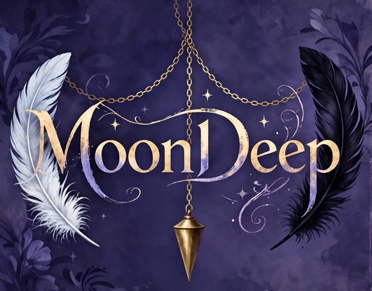

# MoonDeep

A painterly fantasy adventure RPG from Nice Thoughts Ranch.

MoonDeep is the story of **Odette**, a proud knight, and **Odile**,
the cursed alter ego who shares her body — the white swan and the
black swan, negotiating one life between them. Its heart is a pair
of coupled systems. **Battle-Lust** is the expedition clock: a
per-character bar (0–100) raised only by enemy lust-channel
attacks, which never decays in the field — accumulated lust, not
hit points, is what forces the retreat to town, and in its upper
band her commands can be replaced by her own desires. **Depth**
is the campaign-long ratchet beneath it: deliberate hypnotic
conditioning at shrines, moonwells, and a town mesmerist's music
box, where every tier trades a little more of her — susceptibility,
a named trigger, Odile's growing presence — for powers no shallow
girl has. Around those two axes sit the **conditioning tracks**
(Dairy, Service, Doll), each a craving with its own economy,
presentation, and pair of endings — hers to choose, a partner's to
teach, or an enemy's to imprint — and, for the hardest road, the
**Untouched Path**: a vow that pays nothing for a whole campaign
and everything at the end.

## Status

Design complete and approved; build commissioned 2026-10-26.
Nothing is playable yet — the roadmap's slices are core-first and
gate-kept, and the build is honestly reported as "the build at
gate Gn" until it passes the studio play gate (G6).

## Documents of record

- [docs/roadmap.md](docs/roadmap.md) — the build plan: the
  `moondeep-core` / `moondeep-app` architecture, slices S0–S9,
  gates G0–G6, and the open forks.
- [docs/design-conditioning-tracks.md](docs/design-conditioning-tracks.md)
  — the conditioning tracks, sessions and the benefit engine,
  craving, the three launch tracks, and the Untouched Path.
- [docs/design-hypnosis.md](docs/design-hypnosis.md) — the Depth
  system: the bargain, tier by tier, and its fusion with
  Battle-Lust.
- `.ai/memory/` — the repo's working memory: current state,
  decisions, handoffs (bloch layout).
- `skills/moondeep/` — the project skill for working in this
  repository.

## Tech

Rust + Bevy. A pure-Rust core (`moondeep-core`) holds every rule —
Battle-Lust, Depth, tracks, craving, the vow — deterministic and
headless-testable; a thin Bevy shell (`moondeep-app`) draws,
presents the dense-mesh rig, and plays reaction audio. If the
engine were swapped tomorrow, only the shell would change.

MoonDeep's build doubles as a lesson track for the studio's
teaching game, Hands-On: the **Moonlight Track** (M1–M8, designed
in the roadmap §6) twins each MoonDeep slice with a level whose
host pair is Odette and Odile themselves.

## License

BSD 2-Clause — see [LICENSE](LICENSE). Copyright (c) 2026,
Nice Thoughts Ranch.
